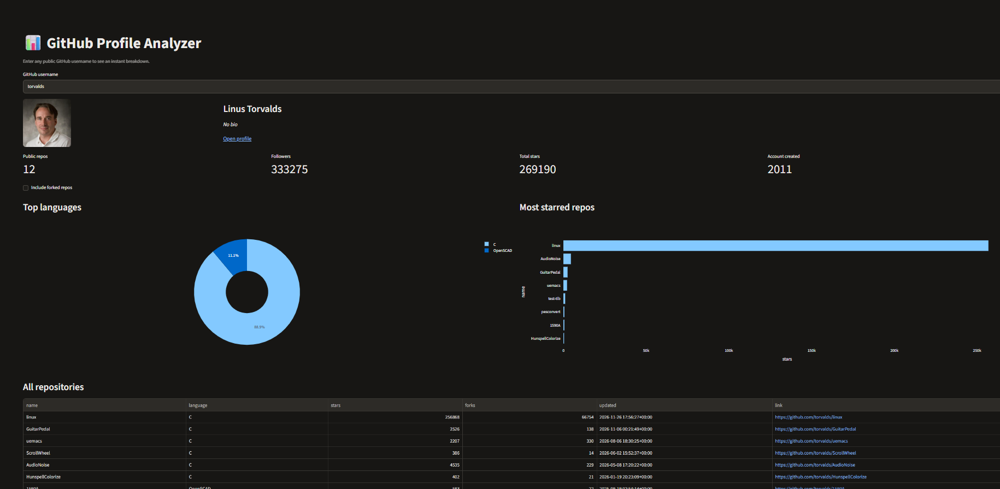

# GitHub Profile Analyzer

A Streamlit app that analyzes any public GitHub profile: stats, top languages,
most-starred repositories, and a full repo table with CSV export.



## Features
- Profile summary: avatar, bio, followers, public repos, total stars
- Language breakdown chart
- Most-starred repositories chart
- Toggle to include or exclude forked repos
- Sortable repo table with clickable links
- CSV download
- API caching and error handling (user not found, rate limits, network issues)

## Tech stack
Python, Streamlit, Requests, Pandas, Plotly, GitHub REST API

## Run locally

1. Clone the repo and open the folder
2. Create and activate a virtual environment
3. Install dependencies and start the app:

```bash
pip install -r requirements.txt
streamlit run app.py
```

## Optional: higher API rate limit

Without a token, GitHub allows 60 requests per hour. To raise it, create a file
`.streamlit/secrets.toml` with:

```toml
GITHUB_TOKEN = "your_token_here"
```

A read-only token for public repositories is enough. Never commit this file.

https://app-profile-analyzer-3p5kkpwhdksjdarpku69jh.streamlit.app/